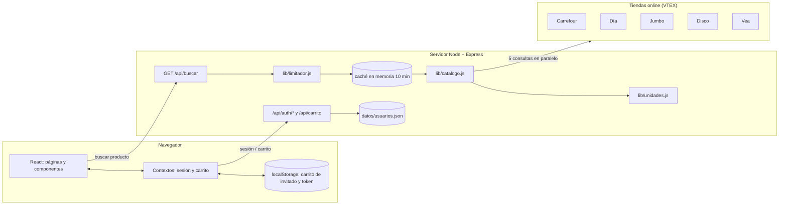
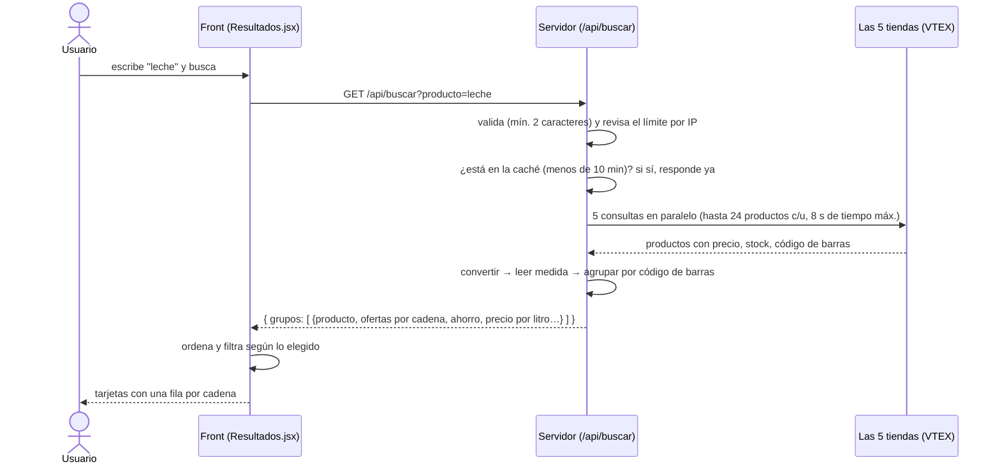

# GondolaYa

**Comparador de precios de supermercados argentinos.** Escribís un producto ("leche", "arroz", "yerba") y
GondolaYa consulta en el momento las tiendas online de **Carrefour, Día, Jumbo, Disco y Vea**, junta el
*mismo producto* de todas las cadenas, calcula el precio por litro / kg / unidad y, si armás un carrito,
te dice **en qué supermercado conviene comprar todo**.

- Front: **React 18** + React Router + Vite.
- Back: **Node.js 18+** + Express (sin base de datos: las cuentas se guardan en un archivo JSON).
- Fuente de datos: la API pública del catálogo de **VTEX**, la plataforma de e-commerce que usan esas cinco tiendas.

---

## Índice

1. [Cómo ejecutarlo](#1-cómo-ejecutarlo)
2. [Vista general del sistema](#2-vista-general-del-sistema)
3. [Qué pasa cuando buscás un producto (paso a paso)](#3-qué-pasa-cuando-buscás-un-producto-paso-a-paso)
4. [Backend](#4-backend)
5. [Cuentas de usuario](#5-cuentas-de-usuario)
6. [Frontend](#6-frontend)
7. [El carrito en detalle](#7-el-carrito-en-detalle)
8. [Pruebas](#8-pruebas)
9. [Estructura de carpetas](#9-estructura-de-carpetas)
10. [Decisiones de diseño y límites conocidos](#10-decisiones-de-diseño-y-límites-conocidos)
11. [Cómo extenderlo](#11-cómo-extenderlo)

---

## 1. Cómo ejecutarlo

Requisitos: **Node.js 18 o superior** (el servidor usa `fetch` global).

```bash
npm install
npm run dev
```

`npm run dev` levanta dos procesos a la vez:

| Proceso | Puerto | Para qué |
|---|---|---|
| API (Express) | `3001` | búsqueda de precios, cuentas, carrito |
| Front (Vite)  | `5173` | la página; reenvía `/api/*` al puerto 3001 |

**Abrí `http://localhost:5173`.**

Para producción (un solo servidor que sirve el front compilado y la API):

```bash
npm run build     # genera dist/
npm start         # http://localhost:3001
```

| Comando | Qué hace |
|---|---|
| `npm run dev` | desarrollo (API + front con recarga automática) |
| `npm run server` / `npm run client` | cada parte por separado |
| `npm run build` | compila el front en `dist/` |
| `npm start` | servidor de producción |
| `npm test` | corre todas las pruebas |

Variables de entorno (todas opcionales):

| Variable | Para qué |
|---|---|
| `PORT` | puerto del servidor (por defecto `3001`) |
| `GONDOLAYA_SECRET` | clave para firmar las sesiones. Si no se define, se genera una y se guarda en `datos/.secret` |
| `GONDOLAYA_USER_AGENT` | `User-Agent` que se manda a las tiendas |
| `VITE_API_URL` | solo si el front se publica en un dominio distinto al de la API |

---

## 2. Vista general del sistema



**Por qué la consulta a las tiendas se hace desde el servidor y no desde el navegador:** las tiendas no
permiten que una página de otro dominio les pida datos directamente (CORS). Desde el servidor no hay ese
problema, y además se puede juntar, ordenar y guardar en caché el resultado.

El sistema tiene tres piezas con responsabilidades separadas:

1. **Catálogo** (`lib/catalogo.js`, `lib/unidades.js`): convierte lo que devuelve VTEX en productos
   ordenados y comparables. No sabe nada de Express ni de React, por eso se puede probar sola.
2. **Cuentas** (`auth.js`): registro, login, sesión y carrito guardado por usuario.
3. **Interfaz** (`src/`): muestra todo, y la lógica del carrito (la parte más delicada) está en un archivo
   puro sin React (`carritoReducer.js`), también probable sola.

---

## 3. Qué pasa cuando buscás un producto (paso a paso)



En palabras:

1. **Se limpia el texto** (espacios, máx. 80 caracteres) y se exigen al menos 2 caracteres.
2. **Se consultan las 5 cadenas a la vez** (`Promise.allSettled`). Si una falla o tarda más de 8 segundos,
   las otras igual responden: la que falló se informa en `fallidos` y la página lo avisa.
3. **Cada respuesta se convierte** en productos con precio (sección 4.2).
4. **Se agrupan** los productos que son el mismo (mismo código de barras) en una sola tarjeta (sección 4.3).
5. **El front ordena y filtra** y muestra el resultado.

---

## 4. Backend

### 4.1 `server.js`: búsqueda y servidor

**Consulta a VTEX.** A cada cadena se le pide:

```
GET {tienda}/api/catalog_system/pub/products/search?ft={texto}&_from=0&_to=23
```

- `ft` es la búsqueda de texto libre; `_to=23` pide hasta 24 productos por cadena (VTEX permite hasta 50;
  pedir más aumenta la chance de que el mismo producto aparezca en varias cadenas).
- VTEX responde `200` o `206` (contenido parcial) cuando anduvo bien; cualquier otro código se toma como error.
- A veces una tienda (se vio en Carrefour) responde `200` pero **sin precios** (sin `sellers`). En ese caso
  se repite el pedido agregando `&sc=1` (canal de ventas), que lo resuelve.
- Tiempo máximo por pedido: 8 segundos. No hace falta API key.

**Caché.** Cada búsqueda se guarda 10 minutos en memoria, para no repetir pedidos a las tiendas. Solo se
guardan búsquedas **completas** (si alguna cadena falló no se cachea, para que el siguiente intento la
vuelva a probar). Si la caché llega a 200 búsquedas, se vacía.

**Otras responsabilidades del servidor:**

- Servir el front compilado (`dist/`) y devolver `index.html` para cualquier ruta de React Router.
- Montar las rutas de cuentas y carrito (sección 5).
- Responder siempre en JSON cuando hay errores (por ejemplo un JSON mal formado).
- Límite de **40 búsquedas por minuto por IP** (`lib/limitador.js`); al pasarse responde `429` con el
  encabezado `Retry-After`.

### 4.2 `lib/catalogo.js` → `convertir()`: de VTEX a productos

VTEX devuelve productos con `items` (variantes) y cada una con `sellers` (vendedores), y cada vendedor con su
oferta. `convertir()` hace esto por cada producto:

1. Recorre todas las variantes y vendedores y se queda con la **oferta disponible más barata** (precio mayor
   a 0 **y** stock mayor a 0). Si no hay ninguna, el producto se descarta.
2. Usa solo el campo `Price`. No se usa `ListPrice` porque en algunas cadenas no es confiable.
3. Toma la primera imagen y el enlace al producto, pero **solo si empiezan con `http://` o `https://`**
   (así no entra ningún `javascript:` ni `data:` desde un dato externo).
4. Lee la **medida** del nombre (sección 4.4).
5. Devuelve: `nombre, marca, precio, supermercado, logo, imagen, url, ean, cantidad`.

### 4.3 `lib/catalogo.js` → `agruparOfertas()`: el mismo producto en varias cadenas

Es lo que convierte una lista de precios en una **comparación**.

- Se agrupa por **código de barras (EAN)**. Antes se le quitan los ceros a la izquierda, porque el mismo
  producto puede venir como `7790742000011` en una cadena y `07790742000011` en otra.
- Los productos **sin código de barras no se juntan con nada**: queda cada uno solo. Prefiere perder una
  comparación antes que inventar una falsa ("estas dos leches parecen iguales").
- Dentro de cada grupo queda **una sola oferta por cadena** (la más barata) ordenadas de menor a mayor precio.
- Cada grupo calcula: `precioMin`, `precioMax`, `ahorro` (máx − mín), `ahorroPct`, y el precio por unidad de
  cada oferta.
- Mismo código de barras significa misma presentación, así que si en alguna cadena se pudo leer la medida,
  se aplica a todas las ofertas del grupo.

Forma de un grupo (lo que recibe el front):

```json
{
  "clave": "ean:7790742000011",
  "nombre": "Leche Entera 1 L",
  "marca": "La Serenísima",
  "imagen": "https://…",
  "medida": "1 L",
  "tipoMedida": "volumen",
  "unidad": "L",
  "precioMin": 1500, "precioMax": 1720,
  "precioUnitarioMin": 1500,
  "ahorro": 220, "ahorroPct": 13,
  "ofertas": [
    { "supermercado": "Día",    "precio": 1500, "precioUnitario": 1500, "url": "…", "ean": "…" },
    { "supermercado": "Jumbo",  "precio": 1720, "precioUnitario": 1720, "url": "…", "ean": "…" }
  ]
}
```

### 4.4 `lib/unidades.js`: precio por litro, kg o unidad

Para poder comparar un sachet de 1 L con un pack de 6 × 1 L hay que llevar todo a la misma medida. VTEX no
trae la medida en un campo confiable, así que se **lee del nombre** del producto con expresiones regulares:

| Nombre | Se interpreta como | Precio por |
|---|---|---|
| `Leche Entera 1 L` | 1000 ml | litro |
| `Aceite 900 cc` | 900 ml | litro |
| `Fideos 500g` / `Yerba 1kg` | 500 g / 1000 g | kg |
| `Coca Cola 2,25 L` | 2250 ml | litro |
| `Gaseosa 6 x 330 ml` | 1980 ml (pack de 6) | litro |
| `Cerveza 473 ml x6` | 2838 ml (pack de 6) | litro |
| `Huevos x 12 u` | 12 unidades | unidad |
| `Pañales Talle G`, `Queso cremoso` | *(sin medida)* | no se muestra |

Reglas de seguridad: si no hay una medida clara devuelve `null` (no se muestra precio por unidad), se
descartan cifras absurdas (más de 50 kg, 50 L o 5000 unidades), y palabras como "lata" no se confunden
con litros ni "3 en 1" con 3 unidades.

El precio por unidad es: **peso → $/kg**, **volumen → $/litro**, **unidades → $/unidad**.

### 4.5 API

| Método y ruta | Requiere sesión | Qué hace |
|---|---|---|
| `GET /api/buscar?producto=leche` | no | busca en las 5 cadenas y devuelve los grupos |
| `POST /api/auth/registro` | no | crea una cuenta y devuelve token + usuario |
| `POST /api/auth/login` | no | inicia sesión y devuelve token + usuario |
| `GET /api/auth/me` | sí | datos del usuario de la sesión |
| `GET /api/carrito` | sí | carrito guardado en la cuenta |
| `PUT /api/carrito` | sí | reemplaza el carrito guardado |

La sesión se manda en el encabezado `Authorization: Bearer <token>`.

Respuesta de `GET /api/buscar`:

```json
{
  "producto": "leche",
  "total": 14,
  "totalGrupos": 6,
  "consultados": ["Carrefour", "Día", "Jumbo", "Disco", "Vea"],
  "fallidos": [],
  "grupos": ["…"]
}
```

`total` es la cantidad de ofertas encontradas (suma de todas las cadenas), `totalGrupos` la de productos
distintos y `fallidos` las cadenas que no respondieron.

Errores: `400` (menos de 2 caracteres), `429` (demasiadas búsquedas), `500` (error al consultar).

---

## 5. Cuentas de usuario

Todo está en `auth.js`, que usa solo el módulo `crypto` de Node (sin librerías extra).

- **Registro:** nombre de 2 a 60 caracteres, email válido, contraseña de 8 a 100 caracteres.
- **Contraseñas:** nunca se guardan. Se guarda un hash **scrypt con sal aleatoria**, y se compara con
  `timingSafeEqual` (comparación en tiempo constante).
- **No revela qué emails existen:** si se intenta ingresar con un email que no existe, igual se calcula un
  hash falso, así la respuesta tarda lo mismo y no se puede descubrir qué cuentas hay.
- **Sesión:** token firmado con **HMAC-SHA256** que vence a los **7 días**. La clave sale de
  `GONDOLAYA_SECRET` o, si no existe, se genera una vez y se guarda en `datos/.secret` (permisos `0600`).
- **Intentos fallidos:** máximo 5 en 15 minutos; pasado eso se bloquea temporalmente.
- **Datos:** `datos/usuarios.json`, escrito de forma segura (se escribe a un archivo temporal y se renombra,
  para que un corte a la mitad no deje el archivo roto). Esa carpeta no se sube a git ni se sirve al público.
- **Carrito en la cuenta:** el servidor **no confía en lo que manda el navegador**: `sanitizarCarrito()`
  limpia cada dato (textos con largo máximo, precios válidos, solo enlaces `http(s)`, logos solo de
  `ass/*.png`), con tope de **100 productos**, **99 unidades** por producto y **8 ofertas** por producto.

> Proyecto académico: guardar usuarios en un archivo funciona bien para una demo, pero no para producción
> (ver [límites](#10-decisiones-de-diseño-y-límites-conocidos)).

---

## 6. Frontend

### 6.1 Páginas (`src/pages/`)

| Ruta | Archivo | Qué muestra |
|---|---|---|
| `/` | `Home.jsx` | portada: buscador, atajos de categorías, "cómo funciona", las 5 cadenas |
| `/resultados?producto=…` | `Resultados.jsx` | los grupos de productos con sus precios por cadena |
| `/carrito` | `Carrito.jsx` | carrito agrupado por cadena + comparador de compra completa |
| `/login`, `/registro` | `Login.jsx` | ingreso y creación de cuenta (una sola página con dos modos) |
| `/fuentes` | `Fuentes.jsx` | de dónde salen los datos y cuáles son sus límites |
| `/privacidad` | `Privacidad.jsx` | qué datos se guardan |
| cualquier otra | `NotFound.jsx` | página no encontrada |

### 6.2 Resultados (`Resultados.jsx`, `GrupoCard.jsx`, `lib/ordenar.js`)

- Mientras busca se muestran tarjetas de carga ("esqueleto"). Si alguna cadena falló, se avisa cuál.
- **Una tarjeta por producto**, con una fila por cadena: precio, precio por litro/kg/unidad, etiqueta
  "Más barato", cuánto se ahorra y botón para agregar al carrito.
- **Orden** (`ordenar.js`, lógica pura):
  - *Mejor precio por unidad* (por defecto): compara solo productos del **mismo tipo de medida** (el más
    común entre los resultados) para no mezclar litros con kilos; los que no se pueden comparar van después.
  - *Menor precio*.
  - *Mayor diferencia entre cadenas*.
- **Filtro:** "solo productos en más de una cadena".
- **Destacado** de arriba: cambia según el orden (mejor precio por litro, precio más bajo, o mayor diferencia).
- Se muestran 20 productos y hay un botón "Mostrar más".
- Mientras se cambia de búsqueda nunca se ven resultados de la búsqueda anterior (la fase se calcula a partir
  del término actual) y se cancela el pedido viejo con `AbortController`.

### 6.3 Contextos (`src/context/`)

- **`AuthContext.jsx`:** guarda la sesión (token y nombre) en `localStorage` y expone el inicio y cierre de sesión.
- **`CarritoContext.jsx`:** expone el carrito y sus acciones a toda la app. Ver sección 7.
- **`carritoReducer.js`:** toda la lógica del carrito, **sin React**.

### 6.4 Estilos (`src/styles/`)

- `estilo.css` y `resultados.css`: el diseño original (colores, tipografías, portada, tarjetas).
- `app.css`: lo agregado después (resultados agrupados, comparador de compra, esqueletos de carga, páginas de
  texto, ajustes de layout). Se carga al final, así que puede ajustar lo anterior.
- El encabezado ocupa todo el ancho de la pantalla y su contenido el ancho normal (`.navbar` + `.navbar__inner`).
  El menú del celular se abre con un checkbox oculto y CSS puro.
- La fila de cadenas de la portada usa `flex` con centrado, así que se acomoda sola con cualquier cantidad de cadenas.

---

## 7. El carrito en detalle

### 7.1 Qué guarda cada producto del carrito

```js
{
  id,                      // "supermercado|código de barras" (identifica al producto en esa cadena)
  nombre, marca, precio, supermercado, logo, imagen, url,
  cantidad,                // 1 a 99
  ean, medida,             // código de barras y presentación ("1 L")
  ts,                      // cuándo se vio el precio (para avisar si está viejo)
  ofertas: [               // el mismo producto en las demás cadenas, al momento de agregarlo
    { supermercado, logo, nombre, precio, imagen, url }
  ]
}
```

Guardar `ofertas` es lo que permite comparar toda la compra sin volver a buscar nada.

### 7.2 Dónde se guarda

- **Sin cuenta (invitado):** en el navegador (`localStorage`).
- **Con cuenta:** en el servidor. Al ingresar se trae el carrito de la cuenta y se **le suma** lo que se
  juntó como invitado. Después cada cambio se guarda automáticamente, **0,5 s después del último cambio**
  (varios clics seguidos son un solo pedido). Si se cierra la pestaña con algo sin guardar, se manda en el acto.
  Si la sesión venció (`401`), se cierra la sesión sola.

### 7.3 Acciones (`carritoReducer.js`)

| Acción | Qué hace |
|---|---|
| `agregar`, `cambiar`, `quitar`, `vaciar` | las básicas (si ya existe, suma cantidad; tope de 99 unidades y 100 productos) |
| `fusionar` | suma el carrito de invitado con el de la cuenta al ingresar |
| `reemplazar` | carga un carrito completo, limpiándolo |
| `cambiarTienda` | pasa un producto a otra cadena, conservando cantidad y datos |
| `reasignar` | pasa **todo** a una cadena, o cada producto a su cadena más barata |
| `actualizar` | reemplaza los datos de un producto (precio nuevo, ofertas nuevas) |

Si al mover productos dos terminan siendo el mismo, **se suman las cantidades** en lugar de duplicarse.

### 7.4 "¿Dónde conviene comprar todo?" (`compararCanasta`)

Para cada cadena que aparezca en alguna oferta se calcula cuánto costaría **toda la lista** ahí:

- Si la cadena tiene todos los productos → "completa", y se ordenan de la más barata a la más cara.
- Si le falta alguno → se muestra aparte con cuántos le faltan (y cuáles, al pasar el mouse).
- **Mejor mezcla:** el mínimo posible eligiendo, producto por producto, la cadena más barata (puede implicar
  comprar en varias cadenas). Se ofrece con un botón que la aplica.
- También se calcula el ahorro entre la cadena completa más barata y la más cara.
- Todo se calcula **en centavos** para evitar errores de decimales de coma flotante.

Además, cada producto avisa si está más barato en otra cadena y permite cambiarlo con un clic (`ahorroPosible`).

### 7.5 Precios viejos y "Actualizar precios"

- Si un precio se guardó hace más de un día, el carrito lo avisa ("hace 3 días…").
- **Actualizar precios** vuelve a buscar cada producto (de a 3 a la vez), lo reconoce por su código de barras
  y le pone el precio de hoy, renovando también las ofertas de las demás cadenas. Informa cuántos pudo
  actualizar y cuántos no (por ejemplo, si ya no está disponible). Como cada producto es una búsqueda, un
  carrito muy grande puede toparse con el límite de 40 búsquedas por minuto.

---

## 8. Pruebas

`npm test` corre todo con el ejecutor de pruebas de Node (`node --test`), sin librerías extra:

| Archivo | Qué comprueba |
|---|---|
| `test/auth.test.js` | registro, login, tokens, bloqueo por intentos, limpieza del carrito del servidor |
| `test/catalogo.test.js` | lectura de medidas, precio por unidad, conversión de VTEX, agrupación por código de barras (incluido el caso de los ceros), una oferta por cadena, límite de pedidos |
| `test/carrito.test.mjs` | reglas del carrito, cambiar de cadena, reasignar, sumar repetidos, comparación de compra, datos peligrosos, actualizar precios |
| `test/ordenar.test.mjs` | orden por unidad / precio / diferencia, filtro, destacado, formatos |

Importante: **las pruebas usan datos simulados**; no consultan a los supermercados reales (eso depende de
internet y de que las tiendas no cambien). Antes de una presentación conviene hacer una búsqueda real.

---

## 9. Estructura de carpetas

```
server.js              búsqueda en VTEX, caché, rutas y servidor de archivos
auth.js                cuentas, contraseñas, tokens, carrito por usuario
lib/
  catalogo.js          cadenas, conversión de VTEX y agrupación por código de barras
  unidades.js          lectura de medidas y precio por litro / kg / unidad
  limitador.js         límite de pedidos por IP
src/
  main.jsx, App.jsx    arranque y rutas
  pages/               Home, Resultados, Carrito, Login, Fuentes, Privacidad, NotFound
  components/          Navbar, Footer, SearchBar, GrupoCard, Cantidad, Campo, Iconos, ScrollToHash
  context/             AuthContext, CarritoContext, carritoReducer (lógica pura)
  lib/                 api.js (llamadas al servidor), formato.js, ordenar.js, useTitulo.js
  styles/              estilo.css, resultados.css (originales) + app.css (agregado)
public/ass/            logos de las cadenas y de GondolaYa
test/                  pruebas
datos/                 (se crea solo) usuarios.json y .secret — no se sube a git
vite.config.mjs        configuración de Vite (reenvía /api al puerto 3001)
```

---

## 10. Decisiones de diseño y límites conocidos

**Decisiones**

- **Preferir no mostrar a mostrar algo falso:** sin código de barras no se agrupa; sin medida clara no hay
  precio por unidad; sin stock, el producto no aparece.
- **La lógica difícil está fuera de React** (`carritoReducer.js`, `ordenar.js`, `catalogo.js`, `unidades.js`)
  para poder probarla sin navegador.
- **El servidor no confía en el navegador:** todo lo que viene de afuera (carrito, enlaces, logos) se valida.
- **Los precios del carrito se guardan con su fecha** y la app avisa cuando están viejos, en vez de mostrarlos
  como si fueran de hoy.

**Límites que hay que tener presentes**

- **Son precios de la tienda online**, no de la góndola: pueden variar según la sucursal o la zona de entrega
  y pueden no incluir promociones que la tienda aplica recién en el carrito.
- **La agrupación depende del código de barras:** si una cadena no lo informa, ese producto no se compara.
- **La medida se lee de un texto:** puede equivocarse con nombres raros. Se avisa en `/fuentes`.
- **Solo cadenas con VTEX.** Coto, por ejemplo, no usa esa plataforma y no se puede consultar igual.
- **Usa la API pública de VTEX de cada cadena:** conviene revisar sus términos de uso antes de publicar el sitio.
- **Usuarios en un archivo JSON:** sirve para demostración; en la mayoría de los hostings gratuitos ese archivo
  se pierde al reiniciar. Para producción haría falta una base de datos.
- **Caché y límite de pedidos en memoria:** se reinician con el servidor. Detrás de un proxy, el límite por IP
  necesita configurar Express para leer la IP real del visitante.
- **No hay recuperación de contraseña ni borrado de cuenta desde la página.**

---

## 11. Cómo extenderlo

**Agregar otra cadena VTEX:** sumar una entrada en `SUPERMERCADOS` (`lib/catalogo.js`) con su nombre, su
dirección base y su logo en `public/ass/`. El resto (búsqueda, agrupación, carrito, comparación) la toma sola.
Para verificar que la tienda sea VTEX, probar en el navegador:
`https://la-tienda.com/api/catalog_system/pub/products/search?ft=leche`.

**Ideas a futuro:** pasar las cuentas a una base de datos, recuperar contraseña, elegir sucursal o código postal,
historial de precios y alertas, y sumar cadenas que no usen VTEX.
